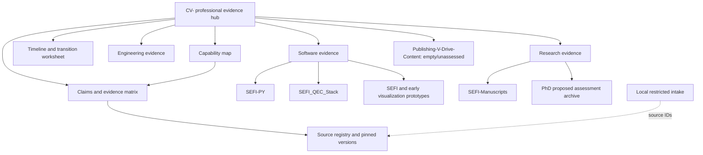

# Archive architecture and knowledge graph

CV- is the proposed central navigation and evidence hub. Specialized repositories retain computational, manuscript and academic artifacts. Raw private sources remain in the local evidence intake. Existing legacy CV- material stays in place; the new README reframes navigation around professional evidence.

Graph data lives in `archive/data`: sources, claims, capabilities and repository provenance. Each assertion has evidence status and activity status independently. Projects and employment assertions remain linked through claim IDs. Duplicated artifacts are versions/copies, not independent achievements.

Future derivative destinations are reserved in the deliverable register: master career record, master CV/resume, full/executive biographies and LinkedIn material. They remain gated until intake/review/conflicts support truthful generation. Structure serves discovered capabilities; titles are historical attributes.

Maintenance: append sources with immutable hashes; date each status change; retain superseded assertions; update known conflicts without rewriting history; refresh repository snapshots only when relevant work changes. Review current employment, credentials, links and journal status before each derivative. No ten-year accuracy guarantee is inferred from this architecture.
